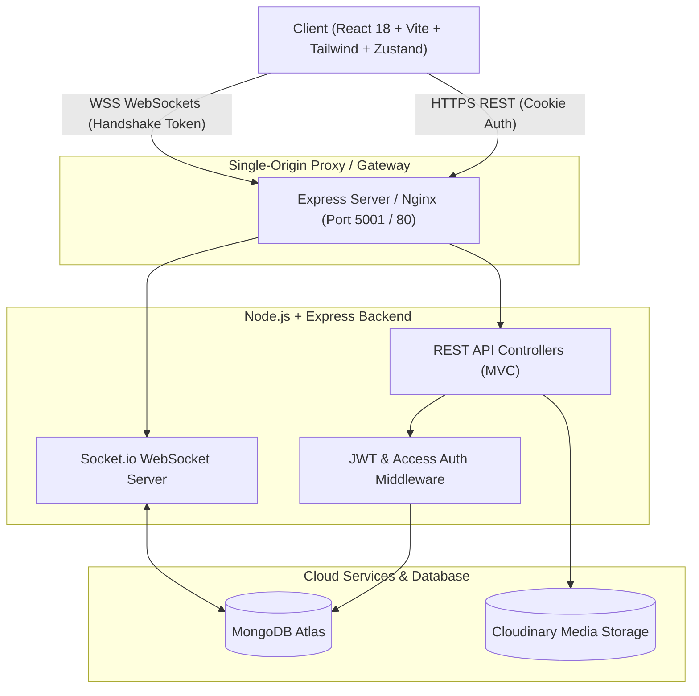

# 💬 ChatSpace — Real-Time Chat & Collaboration Platform

[](https://chatspace-gdm7.onrender.com)
[](LICENSE)
[](https://nodejs.org/)
[](https://react.dev/)
[](https://www.mongodb.com/)
[](https://socket.io/)
[](https://tailwindcss.com/)

A modern, full-stack, Telegram-style real-time messaging workspace built with the **MERN** stack (MongoDB, Express, React, Node.js) and **Socket.io**. Features multi-device synchronization, 1-on-1 and group channels, live presence, read receipts, emoji reactions, media uploads, and containerized Docker deployment.

---

## 🌟 Live Demo

🔗 **Production URL**: [https://chatspace-gdm7.onrender.com](https://chatspace-gdm7.onrender.com)

> *Deployed with unified single-origin architecture on Render and backed by MongoDB Atlas.*

---

## ✨ Features

### 💬 Real-Time Messaging & Channels
- **1-on-1 Direct Messages (DMs)**: Private, instant communication between registered users.
- **Group Channels**: Full group management — admins can add/remove members, rename groups, and delete messages.
- **Reply & Threading**: Quote and reply directly to specific messages with auto-scroll to original.
- **Message Actions**: Edit sent messages (`(edited)` badge), soft-delete for everyone, and toggle emoji reactions.
- **Message Receipts**: Visual single-tick (`✓` sent) and double-tick (`✓✓` read) indicators.
- **Infinite History (Cursor Pagination)**: Smooth upward scrolling loading 30 messages per page without missing arrivals.
- **Rich Media & Attachments**: Image uploads and transformations powered by Cloudinary.

### ⚡ Presence & Real-Time Indicators
- **Live Presence Tracker**: Multi-tab and multi-device accurate online indicators (a user is only marked offline when their last connection disconnects).
- **Live Typing Indicators**: Ephemeral typing feedback (`User is typing...`) isolated per channel room without database overhead.
- **Unread Counters & Badges**: Computed in real-time with single aggregation queries; dynamic browser tab titles showing unread count.

### 🛡️ Security & Architecture
- **Stateless & Cookie Auth**: Secure JWT stored in `httpOnly`, `SameSite=Strict` cookies.
- **Dual-Mode WebSocket Auth**: Handshake supports both session cookies and short-lived handshake tokens for cross-origin setups (Vercel + Render).
- **Centralized Authorization**: Rigid membership checks preventing former group members from accessing historical messages.
- **Hardened HTTP**: Rate limiting via `express-rate-limit`, strict Content Security Policy with `helmet`, and input sanitization.

---

## 🏗️ System Architecture



---

## 🛠️ Tech Stack

| Layer | Technologies |
|---|---|
| **Frontend** | React 18, Vite, Tailwind CSS, Zustand, Lucide Icons, Axios |
| **Backend** | Node.js, Express.js (ES Modules, MVC Architecture) |
| **Realtime Engine** | Socket.io 4.x (Rooms, Handshake Authentication, Ephemeral Events) |
| **Database** | MongoDB Atlas, Mongoose ODM |
| **Media Hosting** | Cloudinary API |
| **DevOps & Containers** | Docker, Docker Compose, Nginx, Render Blueprint (`render.yaml`) |

---

## 🚀 Quick Start (Local Development)

### Prerequisites
- [Node.js (v18+)](https://nodejs.org/)
- [MongoDB](https://www.mongodb.com/) (Local service or free MongoDB Atlas cluster)
- *(Optional)* [Docker Desktop](https://www.docker.com/)

---

### Method A: Run Locally with Node

1. **Clone the repository:**
   ```bash
   git clone https://github.com/partha-21/Mern_Chat_Application.git
   cd Mern_Chat_Application
   ```

2. **Configure Environment Variables:**
   - **Backend:** Create `backend/.env`:
     ```env
     PORT=5001
     MONGO_URI=mongodb://127.0.0.1:27017/chatapp
     JWT_SECRET=your_super_secret_jwt_key_here
     CLIENT_URL=http://localhost:5173
     NODE_ENV=development
     COOKIE_SECURE=false
     TRUST_PROXY=0
     # Optional (for avatar & image attachments)
     CLOUDINARY_CLOUD_NAME=
     CLOUDINARY_API_KEY=
     CLOUDINARY_API_SECRET=
     ```
   - **Frontend:** Create `frontend/.env`:
     ```env
     VITE_PROXY_TARGET=http://localhost:5001
     ```

3. **Install Dependencies & Start:**
   ```bash
   # Terminal 1 - Backend:
   cd backend
   npm install
   npm run dev

   # Terminal 2 - Frontend:
   cd frontend
   npm install
   npm run dev
   ```

4. **Access the App:**
   Open **[http://localhost:5173](http://localhost:5173)** in your browser.

---

### Method B: Run with Docker Compose

Run the entire stack (Frontend, Backend, and MongoDB) with a single command:

```bash
# Copy template environment variables
cp .env.example .env

# Build and start all containers
docker compose up --build
```
Open **[http://localhost:3000](http://localhost:3000)**.

---

## 📡 API Reference

### Authentication (`/api/auth`)
| Method | Endpoint | Description | Access |
|---|---|---|---|
| `POST` | `/api/auth/signup` | Register a new user | Public |
| `POST` | `/api/auth/login` | Authenticate user & issue session cookie | Public |
| `POST` | `/api/auth/logout` | Clear session cookie | Public |
| `GET` | `/api/auth/check` | Rehydrate auth state on page reload | Private |
| `GET` | `/api/auth/socket-token` | Generate 2-minute token for WebSocket handshake | Private |
| `PUT` | `/api/auth/update-profile` | Update user profile image | Private |

### Channels & Groups (`/api/channels`)
| Method | Endpoint | Description | Access |
|---|---|---|---|
| `GET` | `/api/channels` | Retrieve user's active channels & unread count | Private |
| `POST` | `/api/channels/direct` | Access or create 1-on-1 DM channel | Private |
| `POST` | `/api/channels/group` | Create group channel with initial members | Private |
| `PATCH` | `/api/channels/:channelId` | Rename group channel | Group Admin |
| `POST` | `/api/channels/:channelId/members` | Add new members to group | Group Admin |
| `DELETE` | `/api/channels/:channelId/members/:userId` | Remove member or leave group | Member / Admin |

### Messages (`/api/messages`)
| Method | Endpoint | Description | Access |
|---|---|---|---|
| `GET` | `/api/messages/:channelId?before=<date>` | Fetch paginated chat history (30/page) | Channel Member |
| `POST` | `/api/messages/:channelId` | Send a new message (text, image, reply) | Channel Member |
| `PUT` | `/api/messages/:messageId` | Edit sent message | Message Sender |
| `DELETE` | `/api/messages/:messageId` | Soft delete message for all members | Sender / Admin |
| `POST` | `/api/messages/:messageId/react` | Toggle emoji reaction | Channel Member |
| `PUT` | `/api/messages/channel/:channelId/read` | Mark all channel messages as seen | Channel Member |

---

## ⚡ WebSocket Events

| Event | Direction | Payload | Description |
|---|---|---|---|
| `newMessage` | Server ➔ Client | `Message` | Broadcast new message to channel room |
| `messageEdited` | Server ➔ Client | `{ _id, text, editedAt }` | Live message update |
| `messageDeleted` | Server ➔ Client | `{ _id, channelId }` | Live message removal |
| `messageReacted` | Server ➔ Client | `{ _id, reactions }` | Reaction updates |
| `messagesSeen` | Server ➔ Client | `{ channelId, userId }` | Read receipt synchronization |
| `userTyping` | Server ➔ Client | `{ channelId, userId, fullName }` | Typing broadcast |
| `getOnlineUsers` | Server ➔ Client | `string[]` | Online user ID array |

---

## 🚢 Deployment

The repository includes a ready-to-deploy **Render Blueprint** (`render.yaml`):

1. Push your repository to GitHub.
2. In [Render Dashboard](https://dashboard.render.com/), select **New +** ➔ **Blueprint**.
3. Choose this repository.
4. Supply your `MONGO_URI` connection string when prompted.
5. Render automatically builds both the React app and backend server into a single production service.

*For complete deployment walkthroughs and Vercel separation options, see [DEPLOY.md](DEPLOY.md).*

---

## 📄 License

This project is licensed under the [MIT License](LICENSE).

---

## 👨‍💻 Author

**Partha Sarathi K**
- GitHub: [@partha-21](https://github.com/partha-21)
- Project Repository: [Mern_Chat_Application](https://github.com/partha-21/Mern_Chat_Application)
